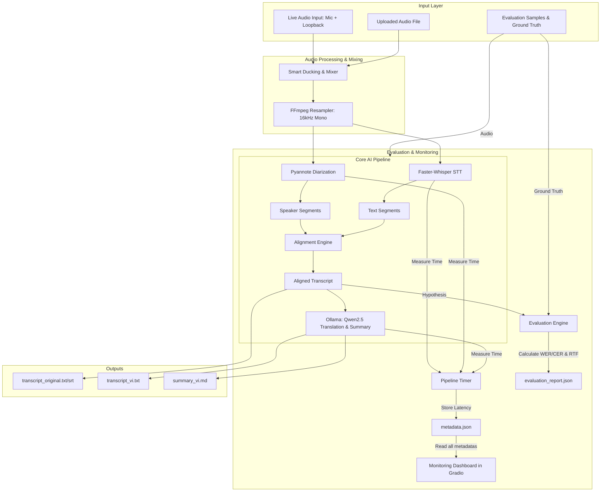

# 🎙️ Offline Multilingual Meeting Transcriber & Summarizer

An enterprise-grade, fully **offline and local** meeting transcription, speaker diarization, and summarization assistant. Built with privacy-first engineering, this application integrates cutting-edge local AI models (**Faster-Whisper**, **Pyannote Audio**, and **Ollama Qwen2.5**) to capture, transcribe, align, translate, and summarize meetings with zero cloud dependency.

---

## 🏗️ System Architecture & Data Flow

The diagram below shows the end-to-end data flow, illustrating how raw audio is captured, processed, and aligned using local models, alongside the MLOps evaluation and monitoring loops.



---

## 💻 Tech Stack & Architectural Decisions

Here we evaluate the core technologies integrated into this project against industry alternatives to justify the architectural choices made.

| Component | Choice | Alternatives | Architectural Justification |
| :--- | :--- | :--- | :--- |
| **Speech-to-Text** | **Faster-Whisper** | OpenAI Whisper API, Whisper.cpp | - **OpenAI API**: Violates privacy requirements; requires internet connectivity.<br>- **Whisper.cpp**: Excellent for C/C++ but less flexible for dynamic Python workflows.<br>- **Faster-Whisper**: Local execution, up to **4x speedup** over OpenAI's PyTorch implementation via `ctranslate2` weight quantization (int8/float16). |
| **Speaker Diarization** | **Pyannote.audio** | Silero VAD, NVIDIA NeMo | - **Silero VAD**: Only detects active voice regions, cannot identify *who* spoke.<br>- **NVIDIA NeMo**: Extremely heavy and complex to set up locally on diverse user machines.<br>- **Pyannote.audio**: State-of-the-art open-source diarization model with high accuracy and active community support. |
| **Local LLM Engine** | **Ollama** | Llama.cpp raw, vLLM, LM Studio | - **Llama.cpp raw**: Hard to manage models, templates, and server settings manually.<br>- **vLLM**: Server-grade; lacks native support for local Windows/macOS client deployments.<br>- **Ollama**: Provides a standardized OpenAI-compatible HTTP API, handles model loading/unloading, and auto-optimizes for CPU/GPU/Apple Silicon out of the box. |
| **LLM Model** | **Qwen2.5 (3B/7B)** | LLaMA 3 (8B), Gemma 2 (9B) | - **LLaMA 3**: Poor native Vietnamese/Japanese localization; prone to code-switching issues.<br>- **Gemma 2**: High hardware requirement; slower inference speed.<br>- **Qwen2.5**: Optimized for multilingual context (Vietnamese, English, Japanese) with excellent summarization capabilities in a compact footprint. |
| **User Interface** | **Gradio** | Streamlit, React + FastAPI | - **React + FastAPI**: Overkill for a local desktop tool; slows down iteration.<br>- **Streamlit**: Lacks flexible events for streaming audio recording callbacks.<br>- **Gradio**: Native Python UI with built-in audio players, timers, and streaming controls. |

---

## ⚡ Technical Challenges & Deep-Dive Solutions

### 1. Acoustic Loopback Feedback & Smart Mixing (Ducking)
**Challenge:** When recording meetings live, capturing both local microphone (host) and system output (remote participants) results in a feedback loop (echo), where system audio is picked up by the microphone and re-amplified.
**Solution:** A custom, real-time mixer in `src/audio/live_capture.py` implements a **Smart Ducking** mechanism. It analyzes the amplitude envelope of the system audio loopback. If remote participant audio is active (RMS > 0.05), it applies a dampening gain of `0.3` to the microphone channel. To avoid abrupt volume changes (audio pops/clicks), a 100ms moving average convolution (`np.convolve`) is applied to smooth the gain transition:

```python
# Extract and align audio chunk envelopes
sys_env = np.abs(lb_processed)
# Target mic gain drops to 0.3 when system output is active
target_gain = np.where(sys_env > 0.05, 0.3, 1.0)
# Smooth gain values using a 100ms sliding window integrated via convolution
window_size = int(self.sample_rate * 0.1)
if window_size > 0:
    window = np.ones(window_size) / window_size
    smoothed_gain = np.convolve(target_gain, window, mode='same')
else:
    smoothed_gain = target_gain
# Mix signals
mixed = (mic_processed * smoothed_gain) + lb_processed
```

### 2. Temporal Alignment of Asynchronous Streams
**Challenge:** Faster-Whisper returns transcription segments with text and character-level timestamps, while Pyannote Audio returns speaker segments with speaker labels. These timelines do not align perfectly.
**Solution:** We built a custom **Alignment Engine** (`src/align.py`) that computes the temporal intersection (overlap) between Whisper transcriptions and Pyannote speaker segments. The segment is assigned to the speaker with the maximum overlap. If no overlap is detected, it falls back to the nearest speaker segment calculated by their midpoints:

```python
def _best_speaker(seg_start: float, seg_end: float, turns: List[SpeakerTurn]) -> str:
    # 1. Look for maximum temporal overlap
    best_turn = None
    best_overlap = 0.0
    for turn in turns:
        ov = max(0.0, min(seg_end, turn.end) - max(seg_start, turn.start))
        if ov > best_overlap:
            best_overlap = ov
            best_turn = turn
    if best_turn is not None and best_overlap > 0:
        return best_turn.speaker

    # 2. Fallback: nearest speaker turn by midpoint distance
    seg_mid = (seg_start + seg_end) / 2
    best_turn = min(turns, key=lambda t: abs((t.start + t.end) / 2 - seg_mid))
    return best_turn.speaker
```

---

## 📊 MLOps: Evaluation & Performance Monitoring

### 1. Automated Offline Evaluation
We implemented a local evaluation harness in `tests/evaluate.py` to calculate accuracy metrics and compute processing speeds:
- **Word Error Rate (WER)**: Evaluates transcription accuracy for English and Vietnamese.
- **Character Error Rate (CER)**: Evaluates Japanese transcription where word boundaries are not space-delimited.
- **Real-Time Factor (RTF)**: Measures latency relative to audio duration:
  $$\text{RTF} = \frac{\text{Pipeline Processing Time}}{\text{Audio Duration}}$$
  *(RTF < 1.0 indicates faster-than-real-time processing).*

Both metrics are computed using a **pure-Python Levenshtein Distance** dynamic programming algorithm, avoiding external library dependency overhead.
Run the evaluation suite:
```powershell
# 1. Generate test WAV files (EN, JA, VI) and ground truth transcriptions
python tests/generate_test_data.py

# 2. Run the evaluation script
python tests/evaluate.py
```

### 2. Live Monitoring Dashboard
Every transcription run logs execution times for each pipeline step into `metadata.json`:
- `audio_conversion_s`, `transcription_s`, `diarization_s`, `alignment_s`, `translation_s`, `summarization_s`.

The **Gradio UI** displays this data in the **"📊 Thống kê & Giám sát"** tab, rendering:
- KPI metrics (total meetings, total transcribed time, average RTF).
- A latency breakdown table comparing the time cost of each pipeline component.
- Meeting language distribution statistics.

---

## 🚀 Getting Started

### Prerequisites
- **Python 3.11**
- **Ollama** (locally installed and serving)
- **NVIDIA GPU** with CUDA support is highly recommended for faster Whisper/Pyannote execution.

### Installation & Run

1. Clone the repository and navigate into the folder:
   ```bash
   cd meeting-transcriber
   ```
2. Set up the virtual environment:
   ```bash
   python -m venv .venv
   # Windows:
   .venv\Scripts\activate
   # macOS/Linux:
   source .venv/bin/activate
   
   pip install -r requirements.txt
   ```
3. Copy the environment template and insert your **Hugging Face Hub Token** (needed to download Pyannote Models):
   ```bash
   # Windows:
   copy .env.example .env
   # macOS/Linux:
   cp .env.example .env
   ```
   *Edit `.env` and fill in `HF_TOKEN`.*
4. Pull the local LLM model using Ollama:
   ```bash
   ollama pull qwen2.5:7b-instruct
   ```
5. Start the web server:
   ```bash
   python app.py
   ```
6. Open your browser and navigate to `http://localhost:7860`.

---

## 📄 License
This project is open-source and licensed under the **MIT License**.
Third-party models (Whisper, Pyannote, Qwen2.5) are subject to their respective licenses.
